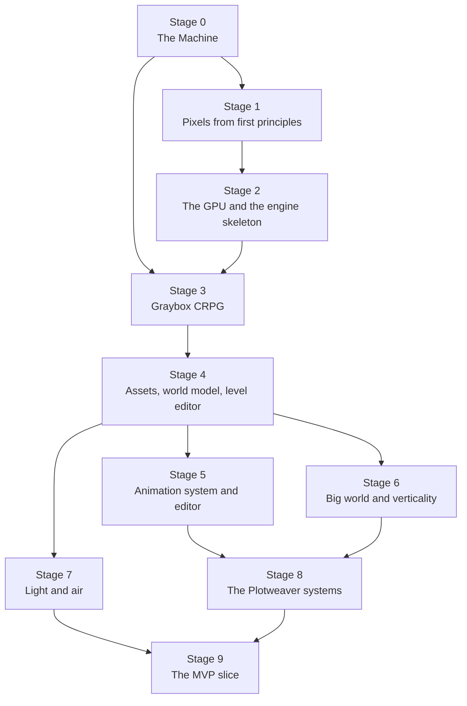

# Roadmap

Back to [[Home]]. The MVP items (E1–E8, G1–G8) are defined in [[North Star and MVP]]. The lessons inside each stage are listed in the [[Curriculum Map]].

## How the stages are ordered

Three ideas shape the order.

- **Learn it small, then build it real.** Stages 0 and 1 use throwaway programs with no engine around them. A pointer bug is much easier to understand in 30 lines than inside a renderer.
- **Ugly game early.** Stage 3 builds a playable fight out of cubes before any real assets, editor or animation exist. You can't judge an engine architecture until a game has leaned on it, so the game leans on it as early as possible.
- **Every stage ends with something that runs** and a gate you have to pass.

Stages 5, 6 and 7 all depend on Stage 4 and not on each other. You can take them in any order, or switch between them when one gets heavy.

## The stages

### Stage 0 — The Machine

*Small programs in `labs/`. No engine.*

- **You learn:** what a compiled program is, how to use a debugger, bits and bytes, integers and floats, pointers, arrays, slices and strings, struct layout, the stack, the heap, lifetimes, allocators, handles, how the CPU cache shapes performance, how to measure, and how to structure a small program (enums, unions, state machines, errors, packages, tests).
- **You build:** your own dynamic array, arena allocator, pool with generational handles, and a hex dump tool. The capstone is the Plotweaver skill-test kernel (d20, modifiers, advantage, the plot die) with tests and a Monte Carlo check against the exact probabilities.
- **MVP:** the first real game code. The rules kernel goes straight into `src/game`.
- **Gate:** you can draw a program's memory on paper at any line, and your allocator and handle code passes its tests.

### Stage 1 — Pixels from first principles

*A software renderer: the CPU fills a pixel buffer, SDL shows it.*

- **You learn:** the whole graphics pipeline by writing it. Colour and framebuffers, lines, vectors, dot and cross products, triangle filling with edge functions, matrices as transforms, coordinate spaces, perspective projection, the depth buffer, clipping, texture mapping, basic lighting.
- **You build:** a lit, textured, spinning cube with no GPU involved.
- **MVP:** nothing directly. This is what makes Stages 2 and 7 understandable.
- **Gate:** you can draw the path of one vertex from model space to a pixel from memory, with the matrix at each step.

### Stage 2 — The GPU and the engine skeleton

*Back in `src/`. You already have a window, input, timing, logging and a triangle here.*

- **You learn:** what the GPU does with what you learned in Stage 1. Buffers, vertex layouts, shaders, uniforms, textures, the depth buffer, uniform blocks, framebuffers, GL debug output. Engine and game layering. A tactical camera. Debug drawing.
- **You build:** a world of lit, textured cubes with a CRPG camera, debug lines and text, and a frame-time readout. You also re-earn the existing platform code by rebuilding parts of it from a blank file.
- **MVP:** the base of E7 and E8.
- **Gate:** no game names in `src/engine`. You can explain every GL call in your renderer.

### Stage 3 — Graybox CRPG

*The first playable thing. Cubes and capsules on a flat map.*

- **You learn:** game architecture under real pressure. Game state as data, a turn loop as a state machine, commands, data-driven definitions, A\* pathfinding, picking with rays, immediate-mode UI with Dear ImGui, testing rules with no window.
- **You build:** a party of n capsules and some NPCs on a flat grid. Click to move. A fight with Plotweaver fast and slow turns, Move and Strike, health and focus, a combat log.
- **MVP:** first versions of G1, G2 and G5.
- **Decisions due:** [[Decisions#DL-02 Movement model|DL-02]], [[Decisions#DL-04 Data format and reload|DL-04]].
- **Gate:** someone else can play a fight to the end. The rules run in tests with no graphics.

### Stage 4 — Assets, world model and level editor

- **You learn:** resource lifetimes and handles in practice, the glTF format, textures and materials, how to store and query game objects (and how to choose between ways of doing it), runtime type information, serialization, undo and redo, gizmos, instancing.
- **You build:** the asset cache, the entity storage you chose, and a level editor with a viewport, hierarchy, inspector, gizmos, undo, save and load.
- **MVP:** E1, first version of E4.
- **Decisions due:** [[Decisions#DL-01 Entity storage|DL-01]], [[Decisions#DL-10 Asset pipeline|DL-10]], [[Decisions#DL-12 Editor and game relationship|DL-12]].
- **Gate:** you build a village block from the Medieval kit in your editor, save it, reload it, and play the Stage 3 fight inside it.

### Stage 5 — Animation system and editor

- **You learn:** skeletons, skinning, sampling keyframes, quaternion interpolation, blending, masks, state machines, events, root motion. Every algorithm is worked on paper before code.
- **You build:** the animation runtime and an animation editor with a timeline, event tracks and a state graph.
- **MVP:** E2, E3.
- **Decisions due:** [[Decisions#DL-09 Animation runtime shape|DL-09]].
- **Gate:** the graybox capsules are replaced by characters who idle, walk, run and attack, and the damage number appears on the hit frame.

### Stage 6 — Big world and verticality

- **You learn:** profiling on the CPU and GPU, frame budgets, spatial data structures, culling, level of detail, streaming, threads and jobs, voxelization, navigation over layered geometry, traversal links.
- **You build:** a 500 m × 500 m streamed map with height. Navigation that understands floors, bridges and cliffs. Jump, drop, climb, fly and teleport. A camera that handles roofs and upper floors.
- **MVP:** E5, E6, E8, G4, the rest of E4.
- **Decisions due:** [[Decisions#DL-05 Navigation for verticality|DL-05]], [[Decisions#DL-07 Streaming unit|DL-07]], [[Decisions#DL-14 Frame budget|DL-14]], [[Decisions#DL-15 Threading|DL-15]].
- **Gate:** the party crosses the whole map and three height levels with no hitch, and you can account for the frame time.

### Stage 7 — Light and air

- **You learn:** radiometry in plain words, physically based shading, normal mapping, HDR and tone mapping, shadow mapping and cascades, handling many lights, fog and volumetrics, sky models, post-processing, particles.
- **You build:** the lighting and atmosphere renderer.
- **MVP:** E7.
- **Decisions due:** [[Decisions#DL-08 Lighting architecture|DL-08]].
- **Gate:** the Stage 6 map at dusk with torches, fog and shadows, inside the frame budget.

### Stage 8 — The Plotweaver systems

- **You learn:** designing rule systems as data, event flow between systems, cellular automata and flood fill, AI for turn-based combat, dialogue as data, tool design for designers.
- **You build:** full combat (reactions, conditions, line of effect, area effects, enemy AI) and the encounter editor. Surfaces, clouds and elemental statuses. Exploration with endeavors and interaction. Conversations and the dialogue editor. The in-game UI.
- **MVP:** G1–G8.
- **Decisions due:** [[Decisions#DL-06 Surface representation|DL-06]], [[Decisions#DL-13 Scripting|DL-13]].
- **Gate:** each system passes its own tests and demo scene.

### Stage 9 — The MVP slice

- **You learn:** integration, performance work against a budget, saving and loading, shipping a build.
- **You build:** the slice, and you run the acceptance walk-through from [[North Star and MVP]].
- **Gate:** the walk-through passes in one sitting.

## After the MVP

Audio, inventory and equipment, character progression, quests, a campaign save system, cinematic dialogue, a second graphics backend, and content.
